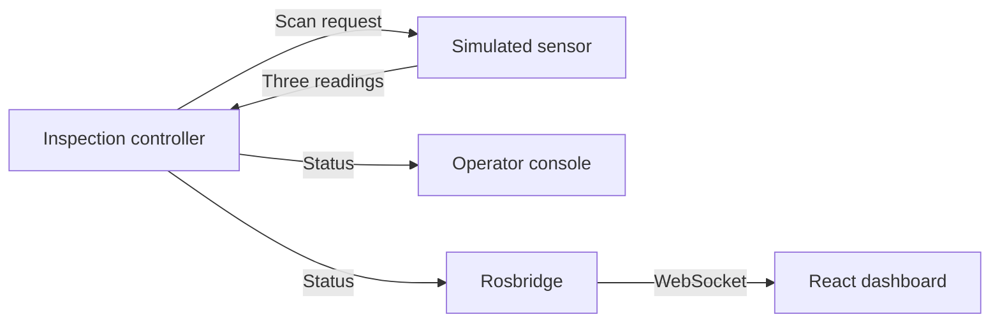

# GadgetInspectra

GadgetInspectra is a **simulated robotic inspection system** built with ROS 2 and a browser dashboard. A controller requests ultrasonic thickness readings, checks three points against a 7.0 mm minimum, and sends status updates to an operator console and an interactive 3D view. A detected thin spot triggers a simulated rework step followed by a new verification scan.

The measurements and arm motion are simulated. The project demonstrates the software workflow and live telemetry; it does not control a physical robot or ultrasonic instrument.

## Why build it?

An inspection measurement is only useful if the system can turn it into a traceable decision. A panel with a thin point must not be accepted because the other points look good, a delayed reading must not be assigned to the next panel, and a failed scan must not quietly count as a pass. GadgetInspectra is a small testbed for those workflow problems: it keeps the sensor, inspection controller, operator display, and browser view as separate components and makes the decision state visible across them.

The current version exercises that workflow with four repeatable simulated scenarios and saves the resulting decisions. It demonstrates communication, threshold checks, and failure handling; it does **not** establish the accuracy of a thickness sensor or the reliability of a quality-control process. Those require representative measurements and evaluation against known outcomes.

## What it shows

- A ROS 2 controller coordinates inspection, analysis, simulated rework, verification, and failure states.
- A separate sensor node responds to scan requests with deterministic three-point thickness measurements.
- Editable scenario input can exercise both a verified repair and a repair that still fails the threshold, as well as a sensor timeout.
- The controller accepts only readings for the current inspection and scan phase, validates the values, and times out if the sensor does not respond.
- An operator console reports measured values and the reason for each pass or failure.
- One audit record per completed inspection saves both sets of readings, the decision, and its reason to a JSON Lines file.
- A React dashboard receives ROS status through Rosbridge WebSocket and shows the inspection state, three readings, threshold, event history, and a rotatable Three.js scene.



## Example inspection

The sensor replays four scenarios in order, then repeats the sequence. Its built-in examples are also provided in `inspection_scenarios.json` so the measurements can be edited without changing the Python node.

| Scenario | Initial readings at P01, P02, P03 | Decision | Verification |
| --- | --- | --- | --- |
| Clear panel | 8.2, 8.1, 8.3 mm | Pass; minimum 8.1 mm | Not needed |
| Thin spot repaired | 8.2, 6.4, 8.3 mm | P02 below 7.0 mm | After simulated rework: 8.2, 8.0, 8.3 mm; pass |
| Thin spot persists | 8.1, 6.6, 8.0 mm | P02 below 7.0 mm | After simulated rework: 8.1, 6.8, 8.0 mm; fail |
| Sensor timeout | No response | Fail after timeout | Not reached |

If a reading is invalid or the sensor does not respond within eight seconds, the controller marks that inspection as failed. The next cycle starts with a new inspection ID.

## Run locally

Use a development environment with ROS 2, `colcon`, the `gadget_inspectra_core` package dependencies, Rosbridge, Node.js, and npm. Run the two parts in separate terminals.

**Terminal 1 — ROS:**

```bash
cd ros2_ws
colcon build --symlink-install
source install/setup.bash
export GADGET_INSPECTION_SCENARIOS="$PWD/src/gadget_inspectra_core/gadget_inspectra_core/inspection_scenarios.json"
ros2 launch gadget_inspectra_core inspection_system.launch.py
```

The sensor can run without the `export` line, using the four scenarios built into its Python module. With the variable set, it reads the JSON file at startup; an invalid or missing file prevents the sensor node from starting. By default the controller appends final decisions to `~/.ros/gadget_inspectra_inspections.jsonl`. Set `GADGET_INSPECTION_AUDIT_LOG` before launch to use a different path. Each line is one JSON object, suitable for filtering by scenario, decision, and error reason.

**Terminal 2 — dashboard:**

```bash
cd dashboard
npm ci
npm run dev -- --host 0.0.0.0
```

Open `http://localhost:5173`. If you are using a development container, forward port `5173` to your browser. The browser must also reach Rosbridge on port `9090`; forward that port if needed. The dashboard connects to `ws://localhost:9090`, shows **ROS ONLINE** once it connects, and clears old telemetry if the connection closes.

To check the flow, watch four inspections: a direct pass, a verified pass after simulated rework, a failed verification, and a sensor timeout. Drag the 3D view to rotate it.

## Code layout

- `ros2_ws/src/gadget_inspectra_core/gadget_inspectra_core/inspection_controller.py` — workflow, threshold decision, scan validation, and status publication.
- `ros2_ws/src/gadget_inspectra_core/gadget_inspectra_core/thickness_sensor.py` — deterministic thickness readings for initial and verification scans.
- `ros2_ws/src/gadget_inspectra_core/gadget_inspectra_core/inspection_scenarios.json` — editable scenario readings; `null` simulates no sensor response.
- `ros2_ws/src/gadget_inspectra_core/gadget_inspectra_core/operator_console.py` — text updates for an operator.
- `ros2_ws/src/gadget_inspectra_core/launch/inspection_system.launch.py` — starts the ROS nodes and Rosbridge.
- `dashboard/src/App.tsx` — live status, readings, and recent updates.
- `dashboard/src/components/InspectionScene.tsx` — state-driven 3D arm and target visualization.

## Scope and limits

This is a software demonstration with synthetic thickness readings. The 3D arm follows workflow states; its motion is not a planned robot trajectory. “Rework” changes the simulated verification reading, without performing a physical repair. The `defect_confidence` field remains in ROS status for compatibility with earlier dashboard code; it is a binary threshold result, **not** a machine-learning probability.

## Next milestone: inspection decisions under uncertain readings

The next version should add repeated readings at each location and independent reference labels. The controller could then distinguish a clear pass, a clear thin spot, and a borderline reading that needs another scan or operator review. The current examples are authored test cases, not a representative inspection dataset.

Success would be measured against those reference labels: count missed thin spots, unnecessary reviews, and decisions made without sufficient readings. The current audit log records readings, decisions, reasons, and timestamps. Verification already uses a separate scenario reading and can fail; the controller still automatically enters a simulated rework stage, so an operator approval step remains future work.

This milestone would make the project a testable inspection decision system while remaining honest that its sensor and robot are simulated. A later integration could replace scenario input with recorded or live thickness measurements.
